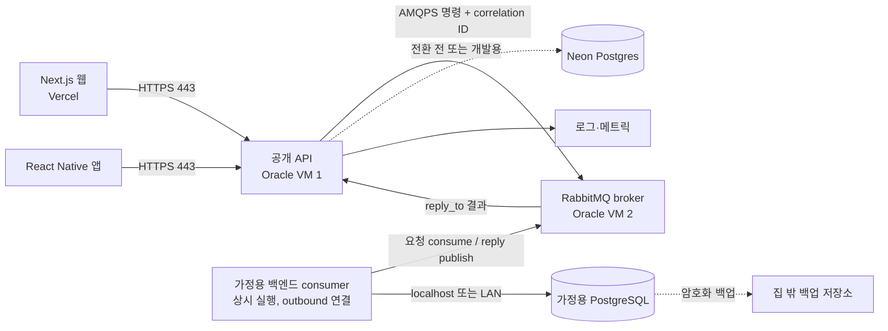
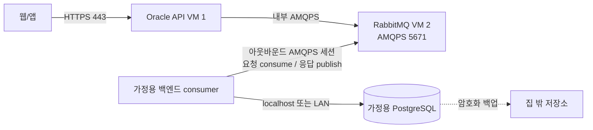

# 저비용 웹·모바일 서비스 아키텍처 제안

- 문서 상태: 제안
- 기준일: 2026-10-15
- 대상: Next.js 웹, React Native 앱, 백엔드 API, 데이터베이스, Oracle Cloud 무료 VM 및 가정용 서버

## 1. 요약

하루 방문자 100명 규모의 저비용 서비스에서 목표 구조는 **Vercel 웹·앱 → Oracle VM의 HTTPS API → Oracle VM의 RabbitMQ → 가정용 백엔드 consumer → 가정용 PostgreSQL**이다. 집의 백엔드는 RabbitMQ에 TLS 연결을 맺고 요청을 받아 로컬 DB 작업을 수행한다. Oracle API는 Request-Reply 응답을 기다린 뒤 HTTPS 응답을 돌려준다. 이 구조는 집 서버에 공개 HTTP/API 포트를 열거나 DB에 직접 원격 접속하지 않게 한다. Neon Free는 전환 전 임시 DB 또는 개발 환경으로만 사용한다.

Neon Free의 일일 접속 제한을 피하기 위해 가정용 PostgreSQL을 운영 DB 후보로 삼고, 집의 별도 백엔드 서비스가 메시지를 소비해 DB 작업을 수행한다. RabbitMQ는 집 서버의 인바운드 애플리케이션 포트 대신 AMQPS 연결을 사용하게 한다. 단, TLS는 전송을 암호화하는 수단이며 인증·권한·접근 제어를 대신하지 않는다. 집의 전원·인터넷·노트북 및 Oracle broker 장애가 서비스 지연이나 중단으로 이어지므로 타임아웃, 재시도, 복구와 외부 백업을 설계한다.

**무료 인프라는 비용을 줄이는 수단이지 상용 서비스의 가용성 보장이 아니다.** 무료 구간의 할당량과 계정별 잔여 한도, 지역별 용량, 정책은 수시로 달라질 수 있으므로 Oracle 콘솔과 Neon 사용량 화면을 기준으로 확인한다.

## 2. 요구사항과 확인된 전제

### 요구사항

- Next.js 웹은 Vercel에서 배포한다.
- React Native 앱은 앱 배포 채널을 통해 배포한다.
- 웹과 모바일 앱이 공통으로 사용할 백엔드 API가 필요하다.
- 클라우드 유료 지출을 당장 감당하기 어렵다.
- Oracle Cloud 무료 VM 3대를 확보했고, Neon DB를 사용 중이다.
- Neon Free의 일일 연결 가능량/사용 가능 시간 제약이 핵심 우려다. 저장 용량은 현재 핵심 병목으로 보지 않는다.
- Oracle 무료 VM은 최소 사양에 가까워 CPU·메모리 여유가 제한적이다. 디스크는 충분할 수 있으며 컴퓨트 병목과 별도로 다룬다.
- 가정용 고성능 노트북에서 PostgreSQL과 별도 백엔드 consumer 서비스를 운영한다. 하루 방문자 100명 규모, 단순 CRUD 중심을 우선 목표로 한다.
- 집 PC는 RabbitMQ에 연결을 시작하는 consumer이며, Oracle에서 집으로 들어오는 HTTP/API 연결은 열지 않는 방향을 검토한다.

### 규모 가정과 설계 기준
- 목표는 하루 방문자 약 100명이다. 이 숫자는 100명 동시 접속을 뜻하지 않는다. 사용자별 요청 수, 방문 집중 시간, API 호출 패턴에 따라 실제 피크 부하와 DB 연결 수는 달라진다.
- 웹·앱에서 보이는 API는 단일 Oracle VM에서 운영한다. 사용자 CRUD는 API가 RabbitMQ에 Request-Reply 메시지를 보내고 집 consumer가 PostgreSQL 작업 후 응답하는 구조로 처리한다. RabbitMQ가 제공하는 요청 중계와 집 consumer의 아웃바운드 연결을 이용해 집 서버의 공개 API/DB 포트를 두지 않는다.
- 출시 전 대표 사용자 여정(CRUD, 로그인, 목록·상세 조회)을 사용해 하루 100명 분량의 요청 프로파일과 예상 피크 시간대 부하를 재현한다. 측정된 CPU·메모리, API 지연, DB pool 대기·연결 수를 기준으로 VM과 DB 위치를 정한다.
- 방문자 100명/일이라는 값만으로 처리량·동시 접속 보장은 계산하지 않는다. 실제 사용량을 관측하고 피크가 예상보다 크면 재평가한다.

### 문서 작성 시점에 확인한 공개 한도

- Neon 공개 문서는 Free 프로젝트별 월 compute allowance와 compute 크기별 동시 연결 상한을 안내한다. 사용자가 경험한 일일 연결 제한이 연결 횟수, 연결 유지 시간, compute 시간 중 무엇으로 집계되는지는 계정 대시보드에서 확인한다. 여기서는 일일 한도를 저장 용량보다 우선하는 운영 제약으로 취급한다. [Neon Free 플랜 안내](https://neon.com/blog/neon-free-plan-1-gb-per-project), [Neon compute 문서](https://neon.com/docs/manage/computes), [Neon connection pooling](https://neon.com/docs/connect/connection-pooling)
- Oracle VM은 최소 사양에 가까운 컴퓨트로 보고 CPU·메모리를 주된 제약으로 취급한다. 공개 문서상 E2 Micro는 1/8 OCPU·1 GB 메모리이고 A1 전체 할당량은 2 OCPU·12 GB 메모리다. 세 VM의 실제 조합과 무료 여부는 콘솔에서 확인한다. 디스크는 충분할 수 있어 주요 병목으로 보지 않는다. [Oracle Always Free 리소스](https://docs.oracle.com/en-us/iaas/Content/FreeTier/freetier_topic-Always_Free_Resources.htm)
- Oracle은 Always Free 컴퓨트가 7일 동안 매우 낮은 CPU·네트워크 사용량을 보이면 유휴 자원으로 회수될 수 있다고 안내한다. 따라서 무료 VM을 영구적인 단일 서비스 기반으로 간주하지 않는다. [Oracle Always Free 리소스](https://docs.oracle.com/en-us/iaas/Content/FreeTier/freetier_topic-Always_Free_Resources.htm)

이 정보는 공개 플랜 문서의 기준이며, 특정 계정의 사용 가능 자원이나 청구 상태를 보증하지 않는다. 특히 사용자가 이미 얻은 인스턴스의 실제 사양은 저장소에서 확인할 수 없으므로 본 제안에서는 확정하지 않는다.

## 3. 권장 목표 구조

### 논리 구성도

Oracle VM 1은 공개 API, Oracle VM 2는 RabbitMQ를 담당한다. 가정용 PC에서는 PostgreSQL과 **별도 백엔드 consumer 프로세스**가 함께 실행된다. Consumer는 먼저 broker에 AMQPS 연결을 맺고 요청을 소비한 뒤, 로컬 DB 트랜잭션을 수행하고 응답을 broker에 게시한다. 집 공유기에는 인바운드 HTTP/API나 DB 포트를 열지 않는다. RabbitMQ가 인터넷에서 연결 가능한 broker listener가 되므로 broker 자체는 강하게 보호해야 한다.

### 동기 CRUD 요청 흐름

1. 웹/앱이 사용자 인증정보와 함께 Oracle API에 HTTPS 요청을 보낸다.
2. API가 인증·인가, 입력 검증, 속도 제한을 수행하고 요청별 correlation ID와 `reply_to`를 정한다.
3. API가 Oracle VM 2의 RabbitMQ에 AMQPS로 CRUD 명령을 보낸다.
4. 집 consumer의 지속적인 outbound AMQPS 연결에서 명령을 받아 허용된 작업인지 확인하고 PostgreSQL 트랜잭션을 수행한다.
5. 트랜잭션 결과를 correlation ID가 포함된 응답 메시지로 `reply_to`에 게시한 뒤, 처리 완료한 요청을 ack한다.
6. API가 일치하는 reply를 제한 시간 안에 받으면 HTTP 응답으로 변환한다. 시간 초과나 연결 단절은 오류 응답으로 돌려준다.

DB 자격 증명은 가정용 consumer에만 둔다. 브라우저와 모바일은 HTTP API만 호출하고 RabbitMQ나 PostgreSQL에 직접 접속하지 않는다.

### 비동기 작업 흐름

CRUD Request-Reply와 별도로, 알림·파일 변환처럼 기다리지 않아도 되는 작업은 별도 비동기 큐와 worker로 처리할 수 있다. 초기에는 집 consumer 하나로 시작하고 실제 작업량이 늘어났을 때만 consumer 수나 역할을 분리한다.

## 4. RabbitMQ Request-Reply 평가

이 설계에서 RabbitMQ는 일반 CRUD의 Request-Reply 통신 경계다. 선택 이유는 **HTTPS보다 AMQPS의 TLS가 더 안전해서가 아니다.** HTTP도 TLS를 적용하면 HTTPS로 암호화되고, RabbitMQ AMQP도 TLS를 적용하면 AMQPS가 된다. 두 프로토콜 모두 TLS 설정, 인증, 권한, 키 관리가 올바를 때 전송 구간을 보호한다. [RabbitMQ TLS 문서](https://www.rabbitmq.com/docs/ssl), [AMQPS URI 규격](https://www.rabbitmq.com/docs/uri-spec)

이 구조에서 메시징을 택하는 실질적인 이유는 다음과 같다.

- 가정용 PC가 broker에 outbound 연결을 시작하므로 집에 공개 HTTP/API endpoint를 두지 않는다.
- Oracle API가 집의 공인 IP, NAT, 라우터 포트 포워딩을 직접 관리하지 않고, 집 DB도 인터넷에 노출하지 않는다.
- DB와 데이터 처리 서비스가 집 내부에 있어 DB 연결을 로컬로 유지한다.
- API와 집 서비스가 broker를 통해 느슨하게 연결되고, 응답 상관 ID와 큐 기반 전달·재연결 처리가 가능하다.

대신 Oracle의 RabbitMQ listener(AMQPS 5671)는 집 consumer가 연결할 수 있도록 도달 가능해야 한다. 즉 집 포트를 닫는 대신 broker를 보호해야 하며, TLS만 켰다고 broker가 안전해지는 것은 아니다. TLS는 기밀성과 전송 중 무결성을 제공하지만, 무단 접속·권한 과다·취약한 비밀번호·서비스 거부를 단독으로 막지 않는다.

Request-Reply는 집 PC나 broker가 중단될 때 응답이 지연되고 큐에 요청이 쌓일 수 있다. 메시지 재전달이나 consumer 장애 때문에 쓰기 작업이 중복될 수도 있다. 요청마다 고유 correlation ID, 유한 timeout, idempotency key, 트랜잭션 커밋 후 ack, 재시도 횟수 제한 및 격리 큐, 큐 적체 알림을 둔다. API는 timeout 시 무한 대기하거나 무조건 재시도하지 않는다. [RabbitMQ RPC 튜토리얼](https://www.rabbitmq.com/tutorials/tutorial-six-javascript)

## 5. DB 및 처리 서비스 배치 선택지

| 선택지 | 장점 | 주요 단점·위험 | 적합한 시점 |
|---|---|---|---|
| Neon을 임시/개발 DB로 유지 | 직접 DB 운영이 필요 없고 설정이 간단함 | 사용자가 지적한 일일 접속 제한이 서비스 시간을 막을 수 있음 | 계정의 일일 제한이 하루 100명 목표에 지장을 주지 않을 때 |
| OCI VM에서 API·RabbitMQ·PostgreSQL 운영 | 모든 cloud 서비스가 한 네트워크에 있음 | 최소 CPU·메모리 자원을 API, broker, DB가 나눠 쓰고 운영 작업도 직접 맡음. 디스크가 충분해도 메모리/CPU 병목은 해결되지 않음 | 대표 부하 시험에서 해당 VM 자원으로 감당됨이 확인될 때만 |
| OCI API + RabbitMQ + 가정용 consumer/PostgreSQL | 집에 공개 API·DB 포트를 열지 않고 로컬 DB와 고성능 PC를 사용. Neon 일일 제한 회피 가능 | AMQPS broker 보안, Request-Reply와 consumer 운영, 집/ISP 정전 시 가용성 저하 | 본 문서의 목표 구조. AMQPS 접근통제 및 timeout·복구 검증을 갖춘 경우 |

**권장 방향:** 하루 방문자 100명 기준, Oracle VM 1은 API, Oracle VM 2는 RabbitMQ broker, 가정용 PC는 별도 consumer와 PostgreSQL 역할을 맡는다. RabbitMQ를 통해 집으로 CRUD 명령을 보내고 응답을 돌려받는다. DB에 대한 WireGuard VPN 직접 접속은 기본 경로로 사용하지 않는다. Neon은 일일 접속 제한이 사용 요구에 맞는지 검증하는 동안 임시로 유지하거나 개발 DB로 둔다.

Neon pooler는 직접 Postgres 동시 연결 수를 줄이는 데 도움이 되지만, 계정에서 확인한 일일 제한이 별도의 접속량/사용시간 한도라면 pooling만으로 해소된다고 가정하지 않는다. 실제 대시보드에서 제한 종류와 재설정 주기를 확인한다. 저장 용량과 디스크는 현재 핵심 의사결정 기준이 아니다.

## 6. 가정용 백엔드와 RabbitMQ 보안·네트워크

### 네트워크 토폴로지

- 집 consumer는 broker에 TLS 연결(AMQPS, 기본 포트 5671)을 시작하고 지속적으로 연결 상태를 확인·복구한다. 집 라우터에는 인바운드 HTTP/API 및 PostgreSQL 포트를 열지 않는다.
- Broker는 집 consumer가 접속할 수 있는 공개 AMQPS endpoint가 된다. API와 broker는 가능한 경우 OCI 내부망으로 연결한다. Oracle ingress에서 5671만 필요한 소스로 허용한다. 집 공인 IP가 고정이면 allowlist를 적용한다. 동적 IP면 인증서 기반 client authentication, 강한 개별 자격 증명, 접속/메시지 제한과 모니터링을 필수로 하며 공개 broker 노출 위험을 감수한다.
- RabbitMQ 서버 인증서를 검증하고 가능하면 mTLS client certificate 인증을 사용한다. API와 집 consumer 계정을 분리하고, 전용 vhost와 최소 queue/exchange read/write 권한만 준다. 기본 `guest` 계정과 익명 접근은 사용하지 않는다. [RabbitMQ TLS](https://www.rabbitmq.com/docs/ssl), [RabbitMQ access control](https://www.rabbitmq.com/docs/access-control)
- AMQPS는 TLS로 AMQP 데이터를 암호화한다. HTTPS도 같은 TLS 기반이므로 이 설계의 보안 이점은 TLS라는 단어가 아니라 집의 공개 HTTP/API·DB listener를 없애고 인증된 outbound consumer와 broker ACL을 사용하는 데 있다.
- AMQP 비암호화 포트 5672와 Management UI 15672는 공개하지 않는다. 관리 UI와 운영 명령은 localhost 또는 별도의 제한된 관리자 경로에서만 접근한다. [RabbitMQ networking](https://www.rabbitmq.com/docs/networking)
- PostgreSQL 5432는 loopback 또는 집 내부에서만 listen하도록 하고 consumer만 DB 자격 증명을 가진다. Consumer는 메시지 타입·입력 스키마·사용자 인가 정보를 검증한 후 DB를 변경한다.
- Consumer와 DB는 재부팅 후 자동 시작하도록 구성하고, broker 연결이 끊어지면 지수 backoff로 재연결한다. 집 인터넷/전원 또는 broker 장애 때 API는 유한 시간 안에 timeout을 반환하고 큐 깊이 및 consumer 상태를 알린다.
- DB 백업은 암호화해 집 밖 장애 영역에 보관하고 정기 복원 시험을 한다.

## 7. Oracle VM 활용 원칙

사용자가 보유한 VM들은 최소 사양에 가까운 컴퓨트라는 전제를 둔다. 디스크가 충분해도 CPU·메모리 한계와 RabbitMQ의 메모리 사용을 별도로 확인한다. 정확한 shape, 리전, 무료 자격과 비용은 OCI 콘솔에서 확인한다.

1. **VM 1: 공개 백엔드 API.** HTTPS reverse proxy, 인증·인가, 입력 검증과 속도 제한을 처리하고 broker에 내부 네트워크로 Request-Reply를 게시한다.
2. **VM 2: RabbitMQ broker.** AMQPS 5671로 집 consumer의 연결을 받고 API와 집 backend 사이 메시지를 중계한다. AMQP 비TLS와 Management UI를 공개하지 않는다.
3. **VM 3: 개발/스테이징, 로그·모니터링 또는 복구 보조.** 실제 자원 용량을 확인하기 전에는 운영의 단일 필수 컴포넌트로 배정하지 않는다.

가정용 PC는 **별도 백엔드 consumer와 PostgreSQL**을 함께 실행한다. DB와 consumer는 로컬로 통신하고 외부에는 포트를 열지 않는다. VM 1·2를 같은 최소 사양 VM에 합치면 비용과 운영 지점은 줄지만 API와 broker가 자원을 경쟁하고 한 번의 VM 장애가 두 계층을 모두 멈춘다. 분리할 수 있는 실제 무료 VM 자원이 확보되어 있는지 먼저 확인한다. 3대가 모두 같은 리전·계정·무료 한도에 묶일 수 있어 고가용성으로 간주하지 않는다.

## 8. 보안과 운영 기준

### 공개 네트워크와 인증

- 공개 ingress는 HTTPS 443과 SSH 관리 접속에 필요한 최소 경로만 허용한다. SSH는 키 기반 인증과 허용 IP 제한을 적용한다.
- PostgreSQL 5432와 RabbitMQ 비TLS AMQP 5672 및 관리 UI 15672는 공개하지 않는다. RabbitMQ 5671 AMQPS는 집 consumer와 API가 접속할 수 있도록 필요한 범위에서만 허용한다.
- API가 사용자 인증과 리소스별 인가를 수행한다. 단순히 로그인 여부만 확인하지 않고 요청 사용자가 대상 데이터의 소유자/권한자인지 검증한다.
- CORS는 웹 도메인만 허용하고, 모바일 앱 접근을 이유로 모든 origin을 허용하지 않는다. CORS는 인증/인가를 대신하지 않는다.
- 속도 제한, 요청 크기 제한, 입력 검증, 로그 내 개인정보·토큰 마스킹을 적용한다.

### 비밀정보와 데이터

- DB 자격 증명은 집 consumer에만 두고, RabbitMQ API/consumer 자격 증명과 TLS private key는 각 서버의 제한된 secret 저장소에 둔다. JWT 비밀키는 API 서버에 둔다. 어떤 비밀정보도 저장소, 앱 바이너리, 클라이언트 번들에 포함하지 않는다.
- 별도 DB 계정과 최소 권한을 사용하고, 운영/개발 자격 증명을 분리한다. 자격 증명은 유출·퇴사·전환 때 교체 가능하게 관리한다.
- DB 백업 빈도와 보존 기간은 데이터 손실 허용치(RPO)에 맞춘다. 복구 소요시간 목표(RTO)와 장애 시 담당 절차도 정한다.
- 백업은 암호화하고 DB와 다른 장애 영역에 저장하며, 정기적으로 복원 검증한다. 백업 파일이 있다는 것만으로 복구 가능성이 보장되지는 않는다.

### 관측과 알림

- API의 성공/오류 비율, 응답시간, DB 연결 오류·pool 대기, 디스크 사용량, VM 메모리·CPU, 큐 적체와 메시지 처리 실패를 관측한다.
- 배포 버전과 request/correlation ID를 로그에 남겨 웹·API·worker 흐름을 연결한다.
- 장애 알림에는 사용자 영향, 우회/복구 순서, 데이터 정합성 확인 절차를 포함한다.

## 9. 단계별 실행 계획과 전환 조건

### 0단계: 자원 및 연결 조건 확인

- OCI에서 VM별 shape, CPU/메모리, 리전, 공인 IP, 무료 자격, 방화벽 규칙과 예상 청구를 확인한다. 특히 VM 1 API와 VM 2 broker를 별도 운영할 실자원이 있는지 확인한다.
- 집 회선의 외부 접속 품질과 공인 IP 변동 여부, 노트북 절전/재부팅, consumer 자동 실행을 점검한다.
- RabbitMQ 계정별 일일 제한이 있다면 계정 화면에서 정확한 단위와 재설정 시각을 기록한다. Neon은 전환 전 임시 환경으로만 고려한다.

**완료 기준:** 하루 100명/일 부하 요구와 home PC의 지속 가동 조건, Oracle VM의 CPU·메모리 및 broker listener 노출 조건을 확인한다.

### 1단계: API·Broker·집 Backend 연결 구축

- Oracle VM 1에 HTTPS API, VM 2에 RabbitMQ를 배포한다. API-to-broker는 OCI 내부 네트워크를 사용하고 집 consumer만 외부 AMQPS endpoint에 접속하도록 한다.
- 집 PC에 별도 consumer 서비스와 PostgreSQL을 배포한다. Consumer는 AMQPS로 연결하고 DB에는 localhost/LAN으로만 연결한다.
- API가 CRUD 명령을 Request-Reply로 게시하고 집 consumer가 DB 트랜잭션을 실행해 결과를 correlation ID와 함께 반환하도록 한다.
- TLS 인증서, API/consumer 별도 RabbitMQ 사용자, vhost/queue 최소 권한, 5671 접근 규칙, 비공개 관리 UI를 적용한다.

**완료 기준:** 하루 100명 요청과 예상 피크를 대표 사용자 흐름으로 재현한다. 집 인바운드 HTTP와 PostgreSQL은 닫혀 있고 집 consumer가 outbound AMQPS로 재연결된다. timeout·집 offline·broker restart·중복 요청·DB transaction rollback·consumer 재시작을 검증한다.

### 2단계: 복구 및 관측 보강

- API→broker→consumer→DB 경로에서 correlation ID를 기록하고 지연·timeout·실패·큐 깊이·consumer 연결을 관측한다.
- DB 백업을 집 밖 암호화 저장소에 보관하고 다른 환경에서 복원 리허설을 한다.
- 실제 비동기 장기 작업이 생기면 사용자 대기 CRUD와 별도 큐로 분리하고 worker 정책을 추가한다.

**완료 기준:** 집 PC 또는 broker 장애 후 consumer가 자동 복구하고, 처리 중 메시지의 재전달/중복을 안전하게 처리하며 백업에서 복구할 수 있다.

### 3단계: Neon 종료 또는 역할 축소

- Neon을 개발·임시 용도로 유지할 이유가 없다면 home PostgreSQL로 데이터를 이관한다.
- 전체 백업, schema/data 이관, row count 및 업무 데이터 검증, 앱 연결 전환과 rollback 기준을 리허설한다.
- 이전 검증이 끝나기 전 기존 데이터를 삭제하지 않는다.

## 10. 핵심 위험과 대응

| 위험 | 영향 | 대응 |
|---|---|---|
| 집 회선/전원/노트북 또는 home consumer 장애 | CRUD 응답 지연, timeout, broker queue 적체 | API timeout, consumer 자동 재연결, 제한된 재시도/격리, 큐 모니터링과 집 밖 백업·복구 |
| 무료 VM 회수/정책·한도 변경 | API, broker 또는 DB 인스턴스가 중단되거나 비용 발생 | 실제 계정 한도와 청구 확인, 구성 재생성 문서화, 백업 외부 보관, 비용 경보·할당량 확인 |
| DB 연결 고갈 | 요청 지연·오류 | pooled connection, 제한된 app pool, 연결 누수 점검, 동시 연결 모니터링 |
| Neon 일일 접속 제한 소진 | DB 작업 제한으로 서비스 지연·중단 | 일일 제한 기준 확인, pooler·연결 재사용 최적화, 사용량 계측과 이전 계획 |
| OCI VM CPU·메모리 부족 | API/DB 지연, OOM, worker 종료 | 부하 시험, API·DB·broker 동시 상주 회피, 핵심 역할만 배치 |
| RabbitMQ 중복 메시지 또는 consumer 장애 | 중복 DB 변경·큐 적체·API timeout | idempotency key, ack-after-commit, 제한 재시도/격리, 큐 깊이·consumer 상태 알림 |
| 백업은 있지만 복구 실패 | 영구 데이터 손실 | 정기 복원 리허설, DB와 다른 장애 영역에 암호화된 백업 보관 |

## 11. 최종 권고

하루 방문자 약 100명과 Neon Free 일일 접속 제약을 고려한 목표 아키텍처는 **Vercel 웹/앱 → Oracle API → RabbitMQ(AMQPS) → 가정용 별도 백엔드 consumer → 로컬 PostgreSQL**이다. 집 backend process는 큐에서 요청을 받아 로컬 DB에 CRUD를 수행하고 correlation ID에 맞춰 응답한다. 이전 문서에서 이 가정용 백엔드 프로세스가 빠져 있었고, 이번 개정에서 명시했다.

RabbitMQ의 선택 이유는 AMQPS가 HTTPS보다 본질적으로 더 강한 암호화여서가 아니다. TLS는 두 프로토콜 모두 보호한다. 이 구조의 보안·운영상 이점은 집의 HTTP/API와 DB 인바운드 포트를 닫고, 집 consumer가 broker에 outbound 연결하며, DB와 백엔드 프로세스를 집 내부에 함께 둔다는 점이다. 반면 Oracle의 RabbitMQ 5671은 집에서 접근 가능해야 하므로 공개 broker endpoint를 TLS/mTLS, 분리된 사용자와 최소 권한, 방화벽 제한, 관리 UI 비공개로 보호한다.

최소 사양 OCI VM은 API와 broker 역할을 분리해 CPU·메모리를 확인하고, 집 서버는 PostgreSQL과 consumer를 함께 운영한다. 모든 사용자 CRUD를 Request-Reply로 처리할 때의 timeout, 큐 적체, 중복 실행, 집 인터넷/전원 장애를 100명/일 대표 부하와 복구 시험으로 확인한다. 디스크는 현재 주된 제약으로 보지 않는다.

## 참고 자료

- [Oracle Cloud Always Free Resources](https://docs.oracle.com/en-us/iaas/Content/FreeTier/freetier_topic-Always_Free_Resources.htm)
- [Oracle Cloud Free Tier FAQ](https://www.oracle.com/cloud/free/faq/)
- [Neon Free Plan update (2026-10-02)](https://neon.com/blog/neon-free-plan-1-gb-per-project)
- [Neon compute and connection limits](https://neon.com/docs/manage/computes)
- [Neon connection pooling](https://neon.com/docs/connect/connection-pooling)
- [RabbitMQ RPC tutorial](https://www.rabbitmq.com/tutorials/tutorial-six-javascript)
- [RabbitMQ TLS support](https://www.rabbitmq.com/docs/ssl)
- [RabbitMQ access control](https://www.rabbitmq.com/docs/access-control)
- [RabbitMQ networking and ports](https://www.rabbitmq.com/docs/networking)

