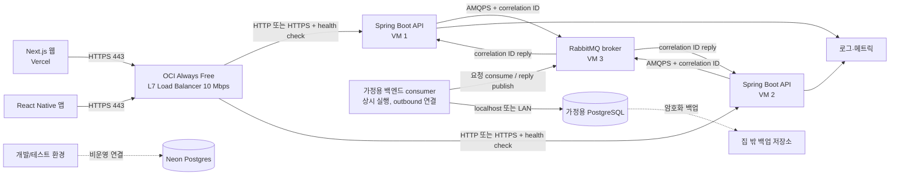
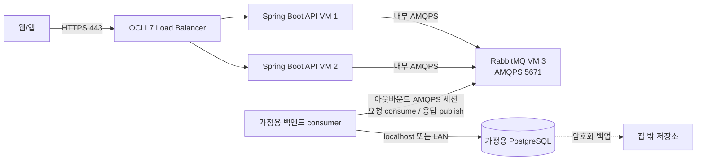

# 저비용 웹·모바일 서비스 아키텍처 제안

- 문서 상태: 제안
- 기준일: 2026-10-15
- 대상: Next.js 웹, React Native 앱, 백엔드 API, 데이터베이스, Oracle Cloud 무료 VM 및 가정용 서버

## 1. 요약

하루 방문자 100명 규모의 저비용 서비스에서 목표 구조는 **Vercel 웹·앱 → OCI Always Free L7 Load Balancer → VM 1·2의 Spring Boot API replica → VM 3의 RabbitMQ → 가정용 백엔드 consumer → 가정용 PostgreSQL**이다. 집의 백엔드는 RabbitMQ에 TLS 연결을 맺고 요청을 받아 로컬 DB 작업을 수행한다. API replica들은 Request-Reply 응답을 기다린 뒤 HTTPS 응답을 돌려준다. VM 1 또는 VM 2의 API가 중단되면 L7 Load Balancer가 비정상 backend를 제외하고 나머지 API 노드로 새 요청을 보낸다. 이 구성은 집 서버에 공개 HTTP/API 포트를 열거나 DB에 직접 원격 접속하지 않게 한다. Neon Free는 개발·테스트 환경으로 활용한다.

Neon Free의 일일 접속 제한을 피하기 위해 가정용 PostgreSQL을 운영 DB 후보로 삼고, 집의 별도 백엔드 서비스가 메시지를 소비해 DB 작업을 수행한다. RabbitMQ는 집 서버의 인바운드 애플리케이션 포트 대신 AMQPS 연결을 사용하게 한다. 단, TLS는 전송을 암호화하는 수단이며 인증·권한·접근 제어를 대신하지 않는다. 집의 전원·인터넷·노트북 및 Oracle broker 장애가 서비스 지연이나 중단으로 이어지므로 타임아웃, 재시도, 복구와 외부 백업을 설계한다.

**무료 인프라는 비용을 줄이는 수단이지 상용 서비스의 가용성 보장이 아니다.** 무료 구간의 할당량과 계정별 잔여 한도, 지역별 용량, 정책은 수시로 달라질 수 있으므로 Oracle 콘솔과 Neon 사용량 화면을 기준으로 확인한다.

## 2. 요구사항과 확인된 전제

### 요구사항

- Next.js 웹은 Vercel에서 배포한다.
- React Native 앱은 앱 배포 채널을 통해 배포한다.
- 웹과 모바일 앱이 공통으로 사용할 백엔드 API가 필요하다.
- 클라우드 유료 지출을 당장 감당하기 어렵다.
- Oracle Cloud 무료 VM 3대를 확보했고, Neon DB를 사용 중이다.
- Neon Free의 일일 연결 가능량/사용 가능 시간 제약이 핵심 우려다. 저장 용량은 현재 핵심 병목으로 보지 않는다.
- Oracle 무료 VM은 최소 사양에 가까워 CPU·메모리 여유가 제한적이다. 디스크는 충분할 수 있으며 컴퓨트 병목과 별도로 다룬다.
- 가정용 고성능 노트북에서 PostgreSQL과 별도 백엔드 consumer 서비스를 운영한다. 하루 방문자 100명 규모, 단순 CRUD 중심을 우선 목표로 한다.
- 집 PC는 RabbitMQ에 연결을 시작하는 consumer이며, Oracle에서 집으로 들어오는 HTTP/API 연결은 열지 않는 방향을 검토한다.

### 규모 가정과 설계 기준
- 목표는 하루 방문자 약 100명이다. 이 숫자는 100명 동시 접속을 뜻하지 않는다. 사용자별 요청 수, 방문 집중 시간, API 호출 패턴에 따라 실제 피크 부하와 DB 연결 수는 달라진다.
- 웹·앱에서 보이는 API는 단일 Oracle VM에서 운영한다. 사용자 CRUD는 API가 RabbitMQ에 Request-Reply 메시지를 보내고 집 consumer가 PostgreSQL 작업 후 응답하는 구조로 처리한다. RabbitMQ가 제공하는 요청 중계와 집 consumer의 아웃바운드 연결을 이용해 집 서버의 공개 API/DB 포트를 두지 않는다.
- 출시 전 대표 사용자 여정(CRUD, 로그인, 목록·상세 조회)을 사용해 하루 100명 분량의 요청 프로파일과 예상 피크 시간대 부하를 재현한다. 측정된 CPU·메모리, API 지연, DB pool 대기·연결 수를 기준으로 VM과 DB 위치를 정한다.
- 방문자 100명/일이라는 값만으로 처리량·동시 접속 보장은 계산하지 않는다. 실제 사용량을 관측하고 피크가 예상보다 크면 재평가한다.

### 문서 작성 시점에 확인한 공개 한도

- Neon 공개 문서는 Free 프로젝트별 월 compute allowance와 compute 크기별 동시 연결 상한을 안내한다. 사용자가 경험한 일일 연결 제한이 연결 횟수, 연결 유지 시간, compute 시간 중 무엇으로 집계되는지는 계정 대시보드에서 확인한다. 여기서는 일일 한도를 저장 용량보다 우선하는 운영 제약으로 취급한다. [Neon Free 플랜 안내](https://neon.com/blog/neon-free-plan-1-gb-per-project), [Neon compute 문서](https://neon.com/docs/manage/computes), [Neon connection pooling](https://neon.com/docs/connect/connection-pooling)
- Oracle VM은 최소 사양에 가까운 컴퓨트로 보고 CPU·메모리를 주된 제약으로 취급한다. 공개 문서상 E2 Micro는 1/8 OCPU·1 GB 메모리이고 A1 전체 할당량은 2 OCPU·12 GB 메모리다. 세 VM의 실제 조합과 무료 여부는 콘솔에서 확인한다. 디스크는 충분할 수 있어 주요 병목으로 보지 않는다. [Oracle Always Free 리소스](https://docs.oracle.com/en-us/iaas/Content/FreeTier/freetier_topic-Always_Free_Resources.htm)
- Oracle은 Always Free 컴퓨트가 7일 동안 매우 낮은 CPU·네트워크 사용량을 보이면 유휴 자원으로 회수될 수 있다고 안내한다. 따라서 무료 VM을 영구적인 단일 서비스 기반으로 간주하지 않는다. [Oracle Always Free 리소스](https://docs.oracle.com/en-us/iaas/Content/FreeTier/freetier_topic-Always_Free_Resources.htm)

이 정보는 공개 플랜 문서의 기준이며, 특정 계정의 사용 가능 자원이나 청구 상태를 보증하지 않는다. 특히 사용자가 이미 얻은 인스턴스의 실제 사양은 저장소에서 확인할 수 없으므로 본 제안에서는 확정하지 않는다.

## 3. 권장 목표 구조

### 논리 구성도

OCI의 관리형 L7 Load Balancer가 공개 HTTPS 진입점이며, VM 1과 VM 2에서 동일한 stateless Spring Boot API를 실행한다. VM 3은 RabbitMQ 전용으로 둔다. Load Balancer는 애플리케이션 HTTP health endpoint를 주기적으로 확인하고 정상 API 노드로 새 요청을 보낸다. 가정용 PC에서는 PostgreSQL과 **별도 백엔드 consumer 프로세스**가 함께 실행된다. Consumer는 먼저 broker에 AMQPS 연결을 맺고 요청을 소비한 뒤, 로컬 DB 트랜잭션을 수행하고 응답을 broker에 게시한다. 집 공유기에는 인바운드 HTTP/API나 DB 포트를 열지 않는다. RabbitMQ가 인터넷에서 연결 가능한 broker listener가 되므로 broker 자체는 강하게 보호해야 한다.

### 동기 CRUD 요청 흐름

1. 웹/앱이 사용자 인증정보와 함께 OCI L7 Load Balancer의 HTTPS endpoint에 요청을 보낸다.
2. Load Balancer가 HTTP health check에서 정상인 VM 1 또는 VM 2의 Spring Boot API로 요청을 분산한다.
3. 해당 API 노드가 인증·인가, 입력 검증, 속도 제한을 수행하고 요청별 correlation ID와 노드별 `reply_to`를 정한다.
4. API가 VM 3의 RabbitMQ에 AMQPS로 CRUD 명령을 보낸다.
5. 집 consumer의 지속적인 outbound AMQPS 연결에서 명령을 받아 허용된 작업인지 확인하고 PostgreSQL 트랜잭션을 수행한다.
6. 트랜잭션 결과를 correlation ID가 포함된 응답 메시지로 해당 API 노드의 `reply_to`에 게시한 뒤, 처리 완료한 요청을 ack한다.
7. API 노드가 일치하는 reply를 제한 시간 안에 받으면 HTTP 응답으로 변환한다. 시간 초과나 연결 단절은 오류 응답으로 돌려준다.

VM 1 API에 장애가 나면 Load Balancer는 health check 실패를 확인한 뒤 VM 2에 새 요청을 보낸다. 이미 VM 1에서 처리 중이던 HTTP 연결은 자동으로 다른 API 노드에서 이어서 실행되지 않는다. 클라이언트 재시도 시 중복 변경이 발생하지 않도록 쓰기 API에 idempotency key를 적용한다. RabbitMQ reply는 요청을 발행한 API 인스턴스의 `reply_to`로만 전달되므로 인스턴스별 reply consumer/queue와 correlation map을 구성하고, API 재시작 시 대기 요청은 timeout으로 종료되도록 설계한다.

DB 자격 증명은 가정용 consumer에만 둔다. 브라우저와 모바일은 HTTP API만 호출하고 RabbitMQ나 PostgreSQL에 직접 접속하지 않는다.

### 비동기 작업 흐름

CRUD Request-Reply와 별도로, 알림·파일 변환처럼 기다리지 않아도 되는 작업은 별도 비동기 큐와 worker로 처리할 수 있다. 초기에는 집 consumer 하나로 시작하고 실제 작업량이 늘어났을 때만 consumer 수나 역할을 분리한다.

## 4. RabbitMQ Request-Reply 평가

이 설계에서 RabbitMQ는 일반 CRUD의 Request-Reply 통신 경계다. 선택 이유는 **HTTPS보다 AMQPS의 TLS가 더 안전해서가 아니다.** HTTP도 TLS를 적용하면 HTTPS로 암호화되고, RabbitMQ AMQP도 TLS를 적용하면 AMQPS가 된다. 두 프로토콜 모두 TLS 설정, 인증, 권한, 키 관리가 올바를 때 전송 구간을 보호한다. [RabbitMQ TLS 문서](https://www.rabbitmq.com/docs/ssl), [AMQPS URI 규격](https://www.rabbitmq.com/docs/uri-spec)

이 구조에서 메시징을 택하는 실질적인 이유는 다음과 같다.

- 가정용 PC가 broker에 outbound 연결을 시작하므로 집에 공개 HTTP/API endpoint를 두지 않는다.
- Oracle API가 집의 공인 IP, NAT, 라우터 포트 포워딩을 직접 관리하지 않고, 집 DB도 인터넷에 노출하지 않는다.
- DB와 데이터 처리 서비스가 집 내부에 있어 DB 연결을 로컬로 유지한다.
- API와 집 서비스가 broker를 통해 느슨하게 연결되고, 응답 상관 ID와 큐 기반 전달·재연결 처리가 가능하다.

대신 Oracle의 RabbitMQ listener(AMQPS 5671)는 집 consumer가 연결할 수 있도록 도달 가능해야 한다. 즉 집 포트를 닫는 대신 broker를 보호해야 하며, TLS만 켰다고 broker가 안전해지는 것은 아니다. TLS는 기밀성과 전송 중 무결성을 제공하지만, 무단 접속·권한 과다·취약한 비밀번호·서비스 거부를 단독으로 막지 않는다.

Request-Reply는 집 PC나 broker가 중단될 때 응답이 지연되고 큐에 요청이 쌓일 수 있다. 메시지 재전달이나 consumer 장애 때문에 쓰기 작업이 중복될 수도 있다. 요청마다 고유 correlation ID, 유한 timeout, idempotency key, 트랜잭션 커밋 후 ack, 재시도 횟수 제한 및 격리 큐, 큐 적체 알림을 둔다. API는 timeout 시 무한 대기하거나 무조건 재시도하지 않는다. [RabbitMQ RPC 튜토리얼](https://www.rabbitmq.com/tutorials/tutorial-six-javascript)

## 5. DB 및 처리 서비스 배치 선택지

| 선택지 | 장점 | 주요 단점·위험 | 적합한 시점 |
|---|---|---|---|
| Neon을 임시/개발 DB로 유지 | 직접 DB 운영이 필요 없고 설정이 간단함 | 사용자가 지적한 일일 접속 제한이 서비스 시간을 막을 수 있음 | 계정의 일일 제한이 하루 100명 목표에 지장을 주지 않을 때 |
| OCI VM 1 API + VM 2 RabbitMQ + 집 DB | 단순하고 자원 역할이 나뉨 | API VM 1 장애가 곧 전체 API 장애. broker도 단일 장애점 | API 장애 대응이 필요하지 않은 실험 단계에서만 |
| OCI L7 LB + VM 1·2 Spring Boot API + VM 3 RabbitMQ + 집 consumer/PostgreSQL | API VM 장애 시 LB가 다른 정상 API에 새 요청을 보내며, 집에 공개 API·DB 포트를 열지 않음 | RabbitMQ, 집 consumer/DB, 가정 회선/전원은 여전히 단일 장애점. 최소 VM에 JVM이 상주하므로 heap/thread 제한 필요 | **권장 목표 구조.** API 노드별 health check와 failover 시험을 통과하는 경우 |

**권장 방향:** VM 장애에도 API가 계속 요청을 처리해야 하므로, OCI Always Free L7 Load Balancer를 공개 진입점으로 두고 VM 1·2에 Spring Boot API replica를 각각 실행한다. VM 3은 RabbitMQ를 맡고 가정용 PC는 consumer와 PostgreSQL을 실행한다. RabbitMQ를 통해 집으로 CRUD 명령을 보내고 응답을 돌려받는다. DB에 대한 WireGuard VPN 직접 접속은 기본 경로로 사용하지 않는다. Neon은 운영 데이터 경로에서 빼고 개발·테스트·스키마 검증에 활용한다.

Neon pooler는 직접 Postgres 동시 연결 수를 줄이는 데 도움이 되지만, 계정에서 확인한 일일 제한이 별도의 접속량/사용시간 한도라면 pooling만으로 해소된다고 가정하지 않는다. 실제 대시보드에서 제한 종류와 재설정 주기를 확인한다. 저장 용량과 디스크는 현재 핵심 의사결정 기준이 아니다.

### Neon을 효율적으로 활용하는 방안

이 아키텍처에서는 **Neon을 운영 사용자 데이터의 캐시 저장소로 두지 않는 것을 권장한다.** 운영 데이터의 단일 원본은 가정용 PostgreSQL로 두고, Neon은 개발·테스트·스테이징 및 스키마/마이그레이션 검증에 사용한다.

| Neon 활용 | 권장도 | 이유와 조건 |
|---|---|---|
| 개발·테스트·스테이징 DB | 권장 | 개발 환경은 사용하지 않을 때 compute가 유휴 상태로 전환되도록 하고, 운영 데이터는 익명화해 사용한다. 브랜치로 스키마 변경을 검증할 수 있다. |
| 운영 사용자 정보의 복제본/캐시 | 비권장 | 가정용 DB와 Neon 간 동기화·무효화·충돌 처리가 추가된다. 요청마다 Neon을 읽으면 운영 경로가 Neon의 compute 가용량과 연결 한도에 다시 의존한다. |
| 가정용 backend의 메타데이터 캐시 | Neon 대신 메모리 | 하루 방문자 100명 목표라면 단일 consumer 프로세스의 제한된 메모리 캐시가 단순하다. 자주 읽히고 변경이 드문 공통 코드표 등만 캐시하고, TTL 또는 변경 시 무효화 정책을 둔다. |
| 권한·역할·세션·인증 정보 캐시 | 매우 제한 | 오래된 권한이 접근을 허용하지 않도록 인증/인가의 원본을 확인한다. 캐시 실패나 불일치 시에는 안전하게 거부하고, 비밀번호·토큰 원문은 캐시/로그에 저장하지 않는다. |
| 백업/재해복구 사본 | 별도 설계 후 검토 | Neon을 백업 사본으로 쓰려면 자동 동기화, 보존, 복구 목표, 복원 절차와 Free 한도에 대한 검증이 필요하다. 단순 복제만으로 자동 failover가 되지는 않는다. |

사용자 프로필, 알림 설정처럼 보존해야 하는 사용자별 데이터는 캐시가 아니라 가정용 PostgreSQL에 저장한다. consumer 내부 캐시는 읽기 성능을 돕는 비권위 데이터로만 사용한다. 이후 consumer를 여러 대로 늘려 프로세스 간 캐시 공유가 필요해지면 Redis 같은 전용 캐시를 검토하되, 하루 100명 목표에서 선제 도입할 이유는 적다.

### Neon의 연결과 사용량을 구분하기

Neon Free의 공개 기준은 **프로젝트별 월 100 CU-hour**다. compute가 0.25 CU로 동작하면 활성 상태 기준 월 최대 400시간에 해당한다. 이는 저장 용량 제한과 다른 항목이다. compute는 기본적으로 5분 동안 비활성 상태면 scale-to-zero로 유휴 전환된다. 따라서 사용자가 말한 “접속 시간”은 연결 요청이나 백그라운드 ping이 compute를 깨우거나 활성 상태를 유지해 compute 사용 시간을 늘리는 현상과 관련 있을 수 있다. 다만 공개 기준상 한도 단위는 연결별 초/일 사용시간이 아니라 **compute 크기(CU) × 활성 시간(CU-hour)**이다. 프로젝트별 정확한 현재 한도는 요금제와 콘솔의 사용량 화면을 확인한다. [Neon Free 플랜 기준](https://neon.com/blog/neon-free-plan-1-gb-per-project), [compute와 scale-to-zero](https://neon.com/docs/manage/computes)

별도로 Postgres의 `max_connections`는 compute 크기에 따른 동시 연결 상한이다. Neon pooled connection은 여러 클라이언트 연결을 더 적은 DB 연결로 다루어 동시 연결 문제를 줄일 수 있지만, 월 CU-hour 사용을 없애거나 compute를 계속 활성 상태로 두는 문제를 해결하지는 않는다. 연결 수 제한과 compute 시간 한도를 서로 다른 지표로 관찰한다. [Neon connection pooling](https://neon.com/docs/connect/connection-pooling)

**운영 점검:** Neon Console에서 compute 사용량과 compute 상태/마지막 활성 시간, 프로젝트의 사용량·제한 오류를 확인한다. 연결이 반복적으로 compute를 깨우는지 확인하려면 앱의 연결 생성·재사용, health check, 주기 작업을 점검한다. Neon Free를 운영에 계속 둘 경우 앱은 연결 단절·compute 재개 지연에 재연결하도록 구성하고, 월 allowance 소진 때 서비스가 어떻게 동작할지 정한다. 현재 제안 구조처럼 운영 API의 데이터 경로에서 Neon을 제거하면 Neon 사용량에 운영 요청이 직접 좌우되지 않는다.

## 6. 가정용 백엔드와 RabbitMQ 보안·네트워크

### 네트워크 토폴로지

- 집 consumer는 broker에 TLS 연결(AMQPS, 기본 포트 5671)을 시작하고 지속적으로 연결 상태를 확인·복구한다. 집 라우터에는 인바운드 HTTP/API 및 PostgreSQL 포트를 열지 않는다.
- Broker는 집 consumer가 접속할 수 있는 공개 AMQPS endpoint가 된다. API와 broker는 가능한 경우 OCI 내부망으로 연결한다. Oracle ingress에서 5671만 필요한 소스로 허용한다. 집 공인 IP가 고정이면 allowlist를 적용한다. 동적 IP면 인증서 기반 client authentication, 강한 개별 자격 증명, 접속/메시지 제한과 모니터링을 필수로 하며 공개 broker 노출 위험을 감수한다.
- RabbitMQ 서버 인증서를 검증하고 가능하면 mTLS client certificate 인증을 사용한다. API와 집 consumer 계정을 분리하고, 전용 vhost와 최소 queue/exchange read/write 권한만 준다. 기본 `guest` 계정과 익명 접근은 사용하지 않는다. [RabbitMQ TLS](https://www.rabbitmq.com/docs/ssl), [RabbitMQ access control](https://www.rabbitmq.com/docs/access-control)
- AMQPS는 TLS로 AMQP 데이터를 암호화한다. HTTPS도 같은 TLS 기반이므로 이 설계의 보안 이점은 TLS라는 단어가 아니라 집의 공개 HTTP/API·DB listener를 없애고 인증된 outbound consumer와 broker ACL을 사용하는 데 있다.
- AMQP 비암호화 포트 5672와 Management UI 15672는 공개하지 않는다. 관리 UI와 운영 명령은 localhost 또는 별도의 제한된 관리자 경로에서만 접근한다. [RabbitMQ networking](https://www.rabbitmq.com/docs/networking)
- PostgreSQL 5432는 loopback 또는 집 내부에서만 listen하도록 하고 consumer만 DB 자격 증명을 가진다. Consumer는 메시지 타입·입력 스키마·사용자 인가 정보를 검증한 후 DB를 변경한다.
- Consumer와 DB는 재부팅 후 자동 시작하도록 구성하고, broker 연결이 끊어지면 지수 backoff로 재연결한다. 집 인터넷/전원 또는 broker 장애 때 API는 유한 시간 안에 timeout을 반환하고 큐 깊이 및 consumer 상태를 알린다.
- DB 백업은 암호화해 집 밖 장애 영역에 보관하고 정기 복원 시험을 한다.

## 7. Oracle VM 활용 원칙

사용자가 보유한 VM은 최소 사양에 가까운 컴퓨트로 본다. 디스크 여유가 있더라도 API 동시 처리, RabbitMQ, 모니터링이 CPU·메모리를 경쟁할 수 있다. 정확한 shape, 리전, 가용 도메인, 무료 자격과 비용은 OCI 콘솔에서 확인한다. VM을 여러 대 보유했다는 사실만으로 이중화나 고가용성이 성립하지 않는다.

### Request-Reply 대기와 API 동시성

Spring Boot API는 브라우저/앱 HTTP 요청을 받고 RabbitMQ에 CRUD 명령을 게시한 다음, correlation ID에 맞는 reply를 기다린다. 이때 **요청 하나당 OS thread를 반드시 하나씩 점유하는 것은 아니다.** Spring MVC의 일반적인 servlet 처리 경로에서 blocking RPC를 호출하면 요청 처리 thread가 대기할 수 있다. 반면 WebFlux와 비동기 AMQP client/비동기 RPC 설계를 사용하면 적은 수의 event-loop thread로 여러 요청을 대기시킬 수 있다. 단, JPA/JDBC 같은 blocking DB 작업을 WebFlux event loop에서 실행하면 안 되며, 가정용 consumer의 DB 작업은 별도 bounded worker pool에서 수행한다. 최소 사양 VM에서 무조건 WebFlux가 낫다고 단정하지 말고, 팀의 구현 경험과 실제 부하·메모리 측정으로 선택한다. JDK 21과 호환되는 유지보수 중인 Spring Boot 버전을 고르고, 선택한 릴리스의 공식 시스템 요구사항을 확인한다. [Spring Boot system requirements](https://docs.spring.io/spring-boot/system-requirements.html)

비동기 방식도 무제한 동시 요청을 감당하는 것은 아니다. 요청별 context·메모리·HTTP 연결이 유지되고, broker/집 consumer가 느려지면 대기 요청이 쌓인다. 다음 보호 장치를 둔다.

- API 인스턴스별 최대 in-flight 요청 수와 RabbitMQ 동시 대기 수를 제한한다. 한도를 넘으면 `429` 또는 `503`과 `Retry-After`를 반환하거나 제한된 대기열만 허용한다.
- 메시지 만료와 요청 timeout을 설정한다. reply가 늦게 도착하면 correlation ID로 무시하거나 만료 처리하고, 재시도에는 idempotency key와 횟수 제한을 적용한다.
- broker 단절, consumer 부재, queue 적체 때 circuit breaker/backpressure로 신규 요청을 빠르게 제한한다. 요청이 무한히 누적되지 않게 한다.
- API 프로세스가 여러 개여도 reply가 원래 API 인스턴스로 돌아오도록 `reply_to` 및 correlation ID를 사용한다. 임시 reply queue의 cleanup과 프로세스 재시작 중 진행 요청의 timeout 동작을 검증한다.

### Gateway/L4와 API 복제의 역할

**우선안은 OCI Always Free Flexible Load Balancer의 L7 HTTP/HTTPS 기능**이다. Oracle 공개 문서 기준 Always Free로 1개, 10 Mbps의 Flexible Load Balancer가 제공되며 backend set에 여러 서버와 HTTP-level health check를 구성할 수 있다. Vercel과 모바일 앱의 HTTPS 진입점은 이 관리형 LB에 두고 VM 1·2의 Spring Boot API를 backend로 등록한다. 공개 10 Mbps 한도가 예상 트래픽에 충분한지 측정하고, 계정의 홈 리전·서비스 한도·콘솔의 Always Free eligibility를 실제 생성 전에 확인한다. [OCI Always Free 리소스](https://docs.oracle.com/en-us/iaas/Content/FreeTier/freetier_topic-Always_Free_Resources.htm), [OCI LB health check](https://docs.oracle.com/en-us/iaas/Content/Balance/Tasks/load_balancer_health_management.htm)

| 진입점 선택지 | 무료 사용 가능성 | 이 구조에서의 역할 | 판단 |
|---|---|---|---|
| OCI Flexible Load Balancer (L7) | Always Free 1개, 10 Mbps 기준. Tenancy/홈 리전/콘솔 eligibility 확인 필요 | HTTPS listener, HTTP readiness health check, VM 1·2에 HTTP 분산. 요청하신 구성에 가장 직접적으로 맞음 | **우선 권장** |
| OCI Flexible Network Load Balancer (L4) | Always Free NLB 1개로 안내됨. OCI Console에서 계정 eligibility 확인 | TCP pass-through 및 연결 분산. L7 기능과 TLS termination은 별도로 앱에서 처리 | L7 LB를 사용할 수 없거나 L4 특성이 필요할 때 대안 |
| VM에 Nginx/HAProxy/Traefik | 소프트웨어는 무료, VM 자원·운영 비용은 발생 | 직접 reverse proxy/load balancing | 단일 VM 배치는 그 VM이 SPOF. 이중 gateway와 공인 IP/DNS failover까지 설계해야 하므로 현 단계 우선안 아님 |
| OCI API Gateway | 무료 제공을 전제하지 않음 | API 관리 기능을 제공하는 별도 계층 | 인증/인가와 HTTP 분산만 필요하면 Spring API + L7 LB로 시작 |

**L4 대안:** Always Free Flexible Network Load Balancer는 L3/L4 pass-through로 TCP 연결을 분산하며, 제품 문서는 추가 사용료가 없다고 안내한다. HTTP 애플리케이션에 사용할 때는 단순 TCP handshake만 확인하지 말고 가능한 HTTP health check를 설정해야 한다. 단, OCI NLB의 tenancy/account eligibility는 상품 페이지와 Free Tier 콘솔에서 확인한다. L4는 HTTP 경로 라우팅이나 TLS termination을 제공하는 API Gateway가 아니다. [OCI Flexible Network Load Balancer](https://www.oracle.com/cloud/networking/flexible-network-load-balancer/), [OCI NLB health check](https://docs.oracle.com/en-us/iaas/Content/NetworkLoadBalancer/HealthCheckPolicies/health-check-policy-management.htm)

이 구성에서 말하는 Load Balancer는 HTTP 요청을 API 노드로 분산하는 진입점이다. 별도의 API Gateway 제품은 API key 정책, quota, API 관리 등이 필요할 때 비교하며, 현재의 저비용 구조에 무료라고 가정해 포함하지 않는다. 인증·인가·요청 검증·속도 제한은 Spring Boot API에서 수행한다.

L7의 TLS termination, 상태 기반 backend 제외, 단일 공인 진입점을 직접 운영하려면 VM에 Nginx/HAProxy/Traefik를 설치할 수 있지만, 이를 VM 1 하나에 두면 VM 1이 다시 단일 장애점이 된다. 별도 API Gateway 상품도 무료 제공을 확인하지 않고 설계 전제에 넣지 않는다. 자체 gateway 두 대를 VM 1·2에 각각 놓는다고 자동으로 public IP/DNS failover가 생기는 것도 아니다. 따라서 무비용 가용성 목표에는 OCI 관리형 Always Free L7 LB를 우선 쓰고, 자체 호스팅 gateway는 로컬 reverse proxy나 별도 장애 조치 설계가 있을 때만 쓴다.

### VM 배치 권고

| 단계 | VM 1 | VM 2 | VM 3 | 가용성 해석 |
|---|---|---|---|---|
| 초기부터 API 노드 장애에 대응 | Spring Boot API replica 1개 | Spring Boot API replica 1개 | RabbitMQ 전용 | OCI 관리형 L7 LB가 VM 1·2로 분산한다. API 노드 하나가 내려가도 정상 노드로 새 요청을 보낼 수 있다. RabbitMQ와 집 DB/consumer는 여전히 단일 장애점이다. |
| API 부하가 측정상 증가 | API replica 유지, 자원·JVM heap 계측 | API replica 유지, 자원·JVM heap 계측 | RabbitMQ 전용 유지 | VM1/2 양쪽에 제한된 heap과 worker 수를 설정한다. 처리량은 낮은 쪽 VM의 여유와 집 consumer 처리 능력에도 제한된다. |
| 서비스 가용성 범위를 더 넓힘 | API replica | API replica | RabbitMQ 이중화 또는 별도 관리형 broker 검토 | API의 VM 장애 대응은 가능하지만 broker, home consumer/PostgreSQL, ISP/전원 장애는 별도 복구/이중화가 필요하다. 무료 3 VM만으로 전체 경로 HA는 아님. |

**기본 권고:** 요청하신 VM 장애 대응을 우선해 OCI 관리형 L7 LB를 앞단에 두고 VM 1·2 모두 동일한 Spring Boot API를 실행하며 VM 3은 RabbitMQ 전용으로 배정한다. 최소 사양이므로 각 VM은 API 인스턴스 1개부터 시작하고 JVM heap, servlet/worker thread pool, RabbitMQ client concurrency를 명시적으로 제한한다. 예를 들어 JVM `-Xms`/`-Xmx`를 무조건 크게 지정하지 말고 `free -m`, RSS, GC pause, CPU, 요청 지연을 보고 작은 값에서 조정한다. 스프링 세션이나 사용자별 상태를 로컬 메모리에 두지 않고, JWT 등 stateless 인증을 사용해 LB sticky session 없이 어느 API 노드에서도 요청을 처리하도록 한다.

하루 방문자 100명만으로 동시 부하가 결정되지는 않으므로 피크 동시 요청, Spring thread 수, in-flight RPC, p95 응답시간, VM 메모리와 집 consumer 처리량을 부하 시험에서 확인한다. API 한 노드가 중단된 상태로도 반대 노드가 정상 요청을 처리하고 LB가 unhealthy 노드를 제외하는지 장애 주입으로 검증한다. LB는 이미 끊긴 HTTP/RPC를 다른 VM에서 이어서 실행하지 않으며, 실패 요청의 재시도에는 idempotency가 필요하다. 가정용 PC에서는 **별도 백엔드 consumer와 PostgreSQL**을 함께 실행하며 DB 포트는 외부에 공개하지 않는다. API 이중화만으로 RabbitMQ·가정용 DB·집 회선까지 가용성이 확보되는 것은 아니다.

## 8. 보안과 운영 기준

### 공개 네트워크와 인증

- 공개 웹/API 진입은 OCI L7 Load Balancer HTTPS 443으로 제한한다. API VM의 Spring Boot 포트는 Load Balancer의 subnet/NSG에서만 접근하도록 하고 public ingress를 직접 열지 않는다. SSH는 키 기반 인증과 허용 IP 제한을 적용한다.
- PostgreSQL 5432와 RabbitMQ 비TLS AMQP 5672 및 관리 UI 15672는 공개하지 않는다. RabbitMQ 5671 AMQPS는 집 consumer가 접속할 수 있도록 필요한 범위에서만 허용하고, API VM은 VCN 내부 규칙으로 연결한다.
- API가 사용자 인증과 리소스별 인가를 수행한다. 단순히 로그인 여부만 확인하지 않고 요청 사용자가 대상 데이터의 소유자/권한자인지 검증한다.
- CORS는 웹 도메인만 허용하고, 모바일 앱 접근을 이유로 모든 origin을 허용하지 않는다. CORS는 인증/인가를 대신하지 않는다.
- 속도 제한, 요청 크기 제한, 입력 검증, 로그 내 개인정보·토큰 마스킹을 적용한다.

### 비밀정보와 데이터

- DB 자격 증명은 집 consumer에만 두고, RabbitMQ API/consumer 자격 증명과 TLS private key는 각 서버의 제한된 secret 저장소에 둔다. JWT 비밀키는 API 서버에 둔다. 어떤 비밀정보도 저장소, 앱 바이너리, 클라이언트 번들에 포함하지 않는다.
- 별도 DB 계정과 최소 권한을 사용하고, 운영/개발 자격 증명을 분리한다. 자격 증명은 유출·퇴사·전환 때 교체 가능하게 관리한다.
- DB 백업 빈도와 보존 기간은 데이터 손실 허용치(RPO)에 맞춘다. 복구 소요시간 목표(RTO)와 장애 시 담당 절차도 정한다.
- 백업은 암호화하고 DB와 다른 장애 영역에 저장하며, 정기적으로 복원 검증한다. 백업 파일이 있다는 것만으로 복구 가능성이 보장되지는 않는다.

### 관측과 알림

- API의 성공/오류 비율, 응답시간, VM별 health 상태, DB 연결 오류·pool 대기, JVM heap/GC, VM 메모리·CPU, 큐 적체와 메시지 처리 실패를 관측한다.
- 배포 버전과 request/correlation ID를 로그에 남겨 웹·API·worker 흐름을 연결한다.
- 장애 알림에는 사용자 영향, 우회/복구 순서, 데이터 정합성 확인 절차를 포함한다.

## 9. 단계별 실행 계획과 전환 조건

### 0단계: 자원 및 연결 조건 확인

- OCI에서 VM별 shape, CPU/메모리, 리전, 공인 IP, 무료 자격, 방화벽 규칙과 예상 청구를 확인한다. OCI Console에서 Always Free Flexible Load Balancer 1개/10 Mbps 자격, 홈 리전, 생성 가능 여부와 예상 청구도 확인한다. VM 1·2의 최소 메모리에서 JDK 21 Spring Boot API 인스턴스 각 1개가 실행 가능한지 heap을 제한해 검증한다.
- 집 회선의 외부 접속 품질과 공인 IP 변동 여부, 노트북 절전/재부팅, consumer 자동 실행을 점검한다.
- Neon Console의 사용량·오류 화면에서 compute CU-hour 소진 여부, 동시 연결 오류(`too many connections` 등), 프로젝트별 제한과 재설정 시점을 구분해 기록한다. 연결 요청이 compute를 자주 깨우는지도 compute 상태/마지막 활성 시각으로 확인한다. Neon은 운영 데이터 경로에 넣지 않고 개발·테스트 DB로 우선 활용한다.

**완료 기준:** 하루 100명/일 부하 요구와 집 PC의 지속 가동 조건, VM 1·2의 Spring Boot 실행 여유, VM 3의 broker listener 조건, L7 Load Balancer의 무료 자격/10 Mbps 한도를 확인한다.

### 1단계: API·Broker·집 Backend 연결 구축

- OCI Always Free Flexible Load Balancer의 L7 HTTPS listener와 HTTP readiness health check를 구성한다. VM 1·2에 동일 버전의 JDK 21 호환 Spring Boot API를 각각 1개 배포하고 두 노드를 backend set에 등록한다. VM 3에 RabbitMQ를 배포한다.
- Spring Boot API 두 인스턴스를 stateless로 구성하고 JWT 인증 등 공유 세션이 필요 없는 방식을 우선한다. 인스턴스별 bounded thread pool, heap limit, RabbitMQ reply consumer/concurrency, `reply_to` 및 correlation ID 처리를 구성한다.
- API-to-broker는 OCI 내부 네트워크를 사용하고 집 consumer만 외부 AMQPS endpoint에 접속하도록 한다.
- 집 PC에 별도 consumer 서비스와 PostgreSQL을 배포한다. Consumer는 AMQPS로 연결하고 DB에는 localhost/LAN으로만 연결한다.
- API가 CRUD 명령을 Request-Reply로 게시하고 집 consumer가 DB 트랜잭션을 실행해 결과를 correlation ID와 함께 반환하도록 한다.
- TLS 인증서, API/consumer 별도 RabbitMQ 사용자, vhost/queue 최소 권한, 5671 접근 규칙, 비공개 관리 UI를 적용한다.

**완료 기준:** 하루 100명 요청과 예상 피크를 대표 사용자 흐름으로 재현한다. 집 인바운드 HTTP와 PostgreSQL은 닫혀 있고 집 consumer가 outbound AMQPS로 재연결된다. timeout·집 offline·broker restart·중복 요청·DB transaction rollback·consumer 재시작을 검증한다.

API의 동기/비동기 I/O 방식, 최대 in-flight 요청, thread pool, CPU·메모리와 p95 지연을 함께 기록한다. 제한에 도달하면 API가 무한 대기하지 않고 정해진 `429`/`503` 응답을 반환하는지 확인한다. VM 1 API를 중단시킨 상태에서 LB가 VM 2로 새 요청을 보내는지, 반대 방향도 같은 방식으로 확인한다. 이미 끊긴 요청은 자동 failover되지 않으므로 쓰기 요청 재시도와 idempotency도 검증한다.

### 2단계: 복구 및 관측 보강

- API→broker→consumer→DB 경로에서 correlation ID를 기록하고 지연·timeout·실패·큐 깊이·consumer 연결을 관측한다.
- DB 백업을 집 밖 암호화 저장소에 보관하고 다른 환경에서 복원 리허설을 한다.
- 실제 비동기 장기 작업이 생기면 사용자 대기 CRUD와 별도 큐로 분리하고 worker 정책을 추가한다.

**완료 기준:** VM 1 또는 VM 2 API 장애 때 정상 노드로 신규 요청이 분산되고, 집 PC 또는 RabbitMQ 장애 후 consumer/API가 정의한 방식으로 복구한다. 처리 중 메시지 재전달/중복을 안전하게 처리하고 백업에서 복구할 수 있다. RabbitMQ 및 가정용 DB는 이 단계에서도 단일 장애점으로 기록한다.

### 3단계: Neon 종료 또는 역할 축소

- Neon을 개발·임시 용도로 유지할 이유가 없다면 home PostgreSQL로 데이터를 이관한다.
- 전체 백업, schema/data 이관, row count 및 업무 데이터 검증, 앱 연결 전환과 rollback 기준을 리허설한다.
- 이전 검증이 끝나기 전 기존 데이터를 삭제하지 않는다.

## 10. 핵심 위험과 대응

| 위험 | 영향 | 대응 |
|---|---|---|
| 집 회선/전원/노트북 또는 home consumer 장애 | CRUD 응답 지연, timeout, broker queue 적체 | API timeout, consumer 자동 재연결, 제한된 재시도/격리, 큐 모니터링과 집 밖 백업·복구 |
| 무료 VM/LB 회수·정책·한도 변경 | API, broker 또는 진입점 중단·비용 발생 | VM 및 LB의 Always Free 자격, 10 Mbps bandwidth cap, 계정별 한도와 청구를 확인하고 구성 재생성 문서화·비용 경보 적용 |
| API VM 한 대 장애 | 해당 노드의 진행 중 요청 실패, 남은 노드에 부하 집중 | L7 LB HTTP readiness health check로 새 요청을 정상 node에 보냄. 잔여 노드 용량을 부하 시험하고 클라이언트 재시도는 idempotency 보장 |
| RabbitMQ VM 3 장애 | 양 API 모두 집 consumer에 CRUD 요청 불가 | broker 장애가 API 이중화로 해결되지 않음을 명시하고 queue/설정 백업, 재기동 절차, outage 응답을 준비. 가용성 요구가 커지면 별도 broker HA 검토 |
| DB 연결 고갈 | 요청 지연·오류 | pooled connection, 제한된 app pool, 연결 누수 점검, 동시 연결 모니터링 |
| Neon compute allowance 또는 동시 연결 한도 도달 | Neon을 사용하는 개발·운영 기능의 DB 연결 실패 | Console에서 CU-hour와 연결 상한 오류를 구분한다. pooler는 동시 DB 연결 완화에만 활용하고, compute 사용량에는 연결 재사용·불필요한 ping 제거·개발 환경 scale-to-zero를 적용한다. 운영 데이터 경로는 Neon 의존성을 제거한다 |
| API Request-Reply 대기 및 OCI VM CPU·메모리 부족 | blocking thread pool 고갈, in-flight 요청 누적, API 지연/OOM | 비동기 I/O 여부 확인, 동시 대기 한도·timeout·backpressure 적용, 지표 기반으로 API replica를 다른 VM에 배치. 한 VM 내 N개 프로세스는 VM 장애를 해결하지 않음 |
| RabbitMQ 중복 메시지 또는 consumer 장애 | 중복 DB 변경·큐 적체·API timeout | idempotency key, ack-after-commit, 제한 재시도/격리, 큐 깊이·consumer 상태 알림 |
| 백업은 있지만 복구 실패 | 영구 데이터 손실 | 정기 복원 리허설, DB와 다른 장애 영역에 암호화된 백업 보관 |

## 11. 최종 권고

하루 방문자 약 100명, 최소 사양 OCI VM, API VM 장애 시 대체 처리를 목표로 하는 권장 아키텍처는 **Vercel 웹/앱 → OCI Always Free Flexible L7 Load Balancer(10 Mbps) → VM 1·2의 JDK 21 호환 Spring Boot API replica → VM 3의 RabbitMQ(AMQPS) → 가정용 별도 backend consumer → 가정용 PostgreSQL**이다. API 노드는 stateless하게 운영하고 각각 bounded concurrency와 JVM 메모리 한도를 둔다. LB health check가 비정상 API 노드를 제외해 새 요청을 남은 노드로 보낸다.

RabbitMQ의 선택 이유는 AMQPS가 HTTPS보다 본질적으로 더 강한 암호화여서가 아니다. TLS는 두 프로토콜 모두 보호한다. 이 구조의 보안·운영상 이점은 집의 HTTP/API와 DB 인바운드 포트를 닫고, 집 consumer가 broker에 outbound 연결하며, DB와 백엔드 프로세스를 집 내부에 함께 둔다는 점이다. 반면 Oracle의 RabbitMQ 5671은 집에서 접근 가능해야 하므로 공개 broker endpoint를 TLS/mTLS, 분리된 사용자와 최소 권한, 방화벽 제한, 관리 UI 비공개로 보호한다.

VM 1/2의 API 이중화는 API 인스턴스 장애에는 대응하지만, 진행 중이던 요청을 다른 노드에서 이어서 실행하지 않으며 RabbitMQ VM 3, 집 consumer/DB, 가정용 인터넷·전원 장애까지 해결하지 않는다. OCI 관리형 L7 Load Balancer를 우선 활용하고, tenancy에서 Free 10 Mbps 구성이 실제로 활성화되는지 확인한다. 하루 방문자 100명/일의 대표 피크 부하와 VM 1/2 개별 정지, broker·집 offline 시나리오에서 지연·오류·재시도·복구를 시험한다. 디스크는 현재 주된 제약으로 보지 않는다.

## 참고 자료

- [Oracle Cloud Always Free Resources](https://docs.oracle.com/en-us/iaas/Content/FreeTier/freetier_topic-Always_Free_Resources.htm)
- [OCI Flexible Load Balancer 생성 및 무료 10 Mbps](https://docs.oracle.com/en-us/iaas/Content/Balance/Tasks/managingloadbalancer_topic-Creating_Load_Balancers.htm)
- [OCI Load Balancer health checks](https://docs.oracle.com/en-us/iaas/Content/Balance/Tasks/load_balancer_health_management.htm)
- [OCI Flexible Network Load Balancer](https://www.oracle.com/cloud/networking/flexible-network-load-balancer/)
- [Spring Boot system requirements](https://docs.spring.io/spring-boot/system-requirements.html)
- [Oracle Cloud Free Tier FAQ](https://www.oracle.com/cloud/free/faq/)
- [Neon Free Plan update (2026-10-02)](https://neon.com/blog/neon-free-plan-1-gb-per-project)
- [Neon compute and connection limits](https://neon.com/docs/manage/computes)
- [Neon connection pooling](https://neon.com/docs/connect/connection-pooling)
- [RabbitMQ RPC tutorial](https://www.rabbitmq.com/tutorials/tutorial-six-javascript)
- [RabbitMQ TLS support](https://www.rabbitmq.com/docs/ssl)
- [RabbitMQ access control](https://www.rabbitmq.com/docs/access-control)
- [RabbitMQ networking and ports](https://www.rabbitmq.com/docs/networking)

