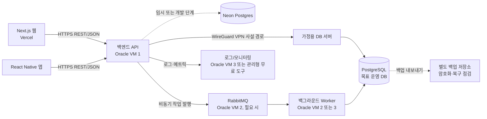
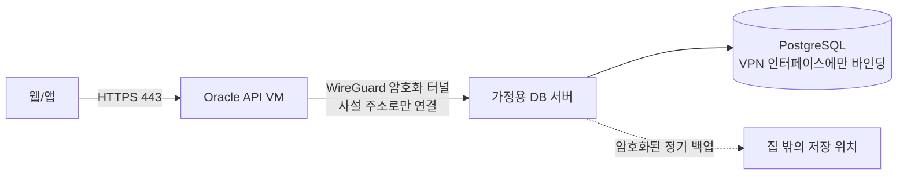

# 저비용 웹·모바일 서비스 아키텍처 제안

- 문서 상태: 제안
- 기준일: 2026-10-15
- 대상: Next.js 웹, React Native 앱, 백엔드 API, 데이터베이스, Oracle Cloud 무료 VM 및 가정용 서버

## 1. 요약

하루 방문자 100명 규모의 저비용 서비스는 처음부터 여러 서비스로 쪼개지 않고, **Vercel 웹·모바일 앱 → Oracle VM의 단일 API → (필요 시 WireGuard VPN) 가정용 PostgreSQL**의 단순한 구조를 목표로 한다. Neon Free의 일일 접속 제한이 실제 서비스 운영을 막지 않는 동안은 임시 DB로 사용할 수 있으며, 제한이 사용 시간에 영향을 주면 집 서버 DB로 전환한다. RabbitMQ는 초기 범위에서 제외하고 비동기 작업이 실제로 생긴 뒤 도입한다.

Neon의 일일 DB 접속 제한에 도달하면 먼저 pooler 구성과 앱 연결 수명·일일 사용량을 점검한다. 병목이 지속되면 DB를 Oracle VM 또는 가정용 PostgreSQL로 이전한다. 저장 공간은 현재 주요 제약이 아니므로 디스크 크기만으로 이전을 결정하지 않는다. 가정용 서버를 주 DB로 사용하는 안은 기술적으로 가능하지만, 집의 전원·인터넷·공유기·노트북 상태가 곧 서비스 가용성이 되므로 운영 복구와 외부 백업을 갖춘 뒤 선택한다.

**무료 인프라는 비용을 줄이는 수단이지 상용 서비스의 가용성 보장이 아니다.** 무료 구간의 할당량과 계정별 잔여 한도, 지역별 용량, 정책은 수시로 달라질 수 있으므로 Oracle 콘솔과 Neon 사용량 화면을 기준으로 확인한다.

## 2. 요구사항과 확인된 전제

### 요구사항

- Next.js 웹은 Vercel에서 배포한다.
- React Native 앱은 앱 배포 채널을 통해 배포한다.
- 웹과 모바일 앱이 공통으로 사용할 백엔드 API가 필요하다.
- 클라우드 유료 지출을 당장 감당하기 어렵다.
- Oracle Cloud 무료 VM 3대를 확보했고, Neon DB를 사용 중이다.
- Neon Free의 일일 연결 가능량/사용 가능 시간 제약이 핵심 우려다. 저장 용량은 현재 핵심 병목으로 보지 않는다.
- Oracle 무료 VM은 최소 사양에 가까워 CPU·메모리 여유가 제한적이다. 디스크는 충분할 수 있으며 컴퓨트 병목과 별도로 다룬다.
- 가정용 고성능 노트북을 DB 서버로 활용하는 안을 검토 중이다. 하루 방문자 100명 규모를 우선 목표로 하며, 트래픽은 단순 CRUD 중심으로 가정한다.

### 규모 가정과 설계 기준
- 목표는 하루 방문자 약 100명이다. 이 숫자는 100명 동시 접속을 뜻하지 않는다. 사용자별 요청 수, 방문 집중 시간, API 호출 패턴에 따라 실제 피크 부하와 DB 연결 수는 달라진다.
- 초기에는 단일 API 인스턴스와 단일 PostgreSQL DB를 사용하고, 동기 CRUD는 HTTP API에서 직접 처리한다. 이 규모에서 RabbitMQ와 API/worker 분리는 기본 요구사항이 아니다.
- 출시 전 대표 사용자 여정(CRUD, 로그인, 목록·상세 조회)을 사용해 하루 100명 분량의 요청 프로파일과 예상 피크 시간대 부하를 재현한다. 측정된 CPU·메모리, API 지연, DB pool 대기·연결 수를 기준으로 VM과 DB 위치를 정한다.
- 방문자 100명/일이라는 값만으로 처리량·동시 접속 보장은 계산하지 않는다. 실제 사용량을 관측하고 피크가 예상보다 크면 재평가한다.

### 문서 작성 시점에 확인한 공개 한도

- Neon 공개 문서는 Free 프로젝트별 월 compute allowance와 compute 크기별 동시 연결 상한을 안내한다. 사용자가 경험한 일일 연결 제한이 연결 횟수, 연결 유지 시간, compute 시간 중 무엇으로 집계되는지는 계정 대시보드에서 확인한다. 여기서는 일일 한도를 저장 용량보다 우선하는 운영 제약으로 취급한다. [Neon Free 플랜 안내](https://neon.com/blog/neon-free-plan-1-gb-per-project), [Neon compute 문서](https://neon.com/docs/manage/computes), [Neon connection pooling](https://neon.com/docs/connect/connection-pooling)
- Oracle VM은 최소 사양에 가까운 컴퓨트로 보고 CPU·메모리를 주된 제약으로 취급한다. 공개 문서상 E2 Micro는 1/8 OCPU·1 GB 메모리이고 A1 전체 할당량은 2 OCPU·12 GB 메모리다. 세 VM의 실제 조합과 무료 여부는 콘솔에서 확인한다. 디스크는 충분할 수 있어 주요 병목으로 보지 않는다. [Oracle Always Free 리소스](https://docs.oracle.com/en-us/iaas/Content/FreeTier/freetier_topic-Always_Free_Resources.htm)
- Oracle은 Always Free 컴퓨트가 7일 동안 매우 낮은 CPU·네트워크 사용량을 보이면 유휴 자원으로 회수될 수 있다고 안내한다. 따라서 무료 VM을 영구적인 단일 서비스 기반으로 간주하지 않는다. [Oracle Always Free 리소스](https://docs.oracle.com/en-us/iaas/Content/FreeTier/freetier_topic-Always_Free_Resources.htm)

이 정보는 공개 플랜 문서의 기준이며, 특정 계정의 사용 가능 자원이나 청구 상태를 보증하지 않는다. 특히 사용자가 이미 얻은 인스턴스의 실제 사양은 저장소에서 확인할 수 없으므로 본 제안에서는 확정하지 않는다.

## 3. 권장 목표 구조

### 논리 구성도

Oracle VM 사양이 최소이므로 초기에 VM 하나는 API 진입점 역할에 집중한다. 가정용 PostgreSQL은 VPN 사설 경로로만 연결하고, 가정 회선 장애가 곧 DB 장애가 된다는 운영 위험을 받아들이는 비용 절감 선택지로 둔다. RabbitMQ, worker, 별도 모니터링 VM은 초기 필수 구성요소가 아니다. VM을 여러 대로 쪼개기보다 실제 병목이 확인된 뒤 분리한다.

### 동기 CRUD 요청 흐름

1. 브라우저 또는 앱이 인증 정보를 포함해 API에 HTTPS 요청을 보낸다.
2. API가 인증·인가, 입력 검증, 속도 제한을 수행한다.
3. API가 DB connection pool을 통해 PostgreSQL에 SQL 트랜잭션을 수행한다. DB가 집에 있는 경우 연결은 WireGuard VPN 사설 주소를 사용한다.
4. API가 성공 또는 구체적인 오류 상태와 결과를 HTTP 응답으로 반환한다.

일반적인 CRUD는 DB를 직접 호출하는 이 경로가 기본이다. 웹과 앱은 같은 API 계약을 쓰며, DB 자격 증명은 클라이언트에 포함하지 않는다.

### 비동기 작업 흐름

1. API가 사용자 작업을 DB에 저장하고, 필요한 비동기 작업을 큐에 넣는다.
2. Worker가 메시지를 처리한 뒤 성공 확인(ack)을 하거나, 제한된 재시도/격리 큐 정책을 따른다.
3. 사용자에게 즉시 결과가 필요 없는 작업은 API가 작업 ID를 반환하고, 클라이언트는 상태 조회 또는 알림을 사용한다.

## 4. RabbitMQ Request-Reply 평가

RabbitMQ의 Request-Reply는 구현 가능한 패턴이다. RabbitMQ 문서는 요청의 `reply_to`와 고유 `correlation_id`를 이용해 응답을 매칭하고, worker 장애 뒤 요청 재처리로 중복 결과가 생길 수 있어 멱등성을 고려하도록 안내한다. [RabbitMQ RPC 튜토리얼](https://www.rabbitmq.com/tutorials/tutorial-six-javascript)

다만 모든 UI CRUD를 `API → RabbitMQ → 집의 worker/DB → 응답 대기`로 보내는 것은 초기 기본안으로 권하지 않는다.

- API 응답이 집의 전원·노트북·ISP 연결에 종속된다. 집이 끊기거나 worker가 내려가면 큐 적체, API 타임아웃, 사용자 오류가 발생한다.
- 웹 요청의 대기 시간이 DB 직접 호출보다 길어질 수 있고, 브라우저·모바일·API·브로커·집 서버 간 장애 원인을 추적하기 어렵다.
- 메시지 재전달이나 worker 재시작 때문에 변경 요청을 멱등하게 설계해야 한다.
- 사용량이 작을 때는 큐와 응답 매칭·타임아웃·재시도·관측을 유지하는 부담이 DB 직접 CRUD의 이득보다 크다.

Request-Reply를 정말 써야 할 때는 짧은 작업에 한정한다. 요청별 고유 correlation ID, 명시적인 reply 주소, 유한 타임아웃, 실패 시 HTTP 오류 매핑, 중복 작업 방지용 idempotency key, 상관 ID 로그, 메시지 크기 제한을 정한다. 브라우저나 모바일 클라이언트가 RabbitMQ에 직접 접속하지 않도록 하고 API만 브로커 자격 증명을 보유한다.

## 5. DB 배치 선택지

| 선택지 | 장점 | 주요 단점·위험 | 적합한 시점 |
|---|---|---|---|
| Neon을 임시/개발 DB로 유지 | 설정과 운영이 간단하고 DB 서버를 직접 관리하지 않아도 됨 | 일일 접속 제한이 운영 시간을 막을 수 있음. 계정의 제한·재설정 시각 확인 필요 | 제한이 하루 100명 대상 서비스 운영에 지장을 주지 않는 초기 검증 기간 |
| Oracle VM의 PostgreSQL | Neon 일일 한도 의존을 없애고 API와 DB를 같은 네트워크에 둘 수 있음 | 최소 CPU·메모리로 API와 DB가 자원을 놓고 경쟁함. 패치·백업·복구도 직접 운영 | CPU·메모리 부하 시험에서 단일 VM이 API와 DB를 함께 감당할 때만 검토 |
| 가정용 PostgreSQL | Neon 일일 접속 한도와 OCI VM의 최소 컴퓨트 제약을 피하면서 기존 고성능 장비를 활용 | 집 전원·인터넷·공유기·노트북 중단이 곧 DB 중단. VPN·복구·집 밖 백업을 직접 운영 | 하루 100명 수준의 사용자에게 중단 위험을 설명하고, VPN·자동 복구·외부 백업을 검증한 경우 목표 운영 DB로 우선 검토 |

**권장 방향:** 하루 방문자 100명 규모에서 Neon의 일일 접속 제한이 서비스 연속성을 허용하면 Neon pooled connection으로 운영을 시작해도 된다. 제한이 실제 고객 이용 시간을 막는다면 pooler 최적화 후 가정용 노트북의 PostgreSQL을 WireGuard VPN으로 Oracle API에 연결하는 구성을 목표로 한다. OCI 최소 사양 VM은 API 역할에 집중하고, DB와 RabbitMQ를 한 VM에 추가하지 않는다. 디스크 용량은 주 판단 기준이 아니다.

Neon은 pooler를 제공하며 문서상 pooled connection은 compute의 직접 `max_connections` 병목을 피하는 방법이다. 따라서 연결 문제가 곧바로 DB 자체를 옮겨야 한다는 뜻은 아니다. 앱 서버리스 환경에서 요청마다 새 연결을 만들지 말고, Neon pooled connection string과 적절한 클라이언트 풀 설정을 사용한다. [Neon connection pooling](https://neon.com/docs/connect/connection-pooling)

이 설계의 입력 조건은 Neon Free 이용 시 하루 단위 연결/접속 제한이 서비스 연속성에 영향을 준다는 점이다. 사용 중인 계정 화면에서 남은 일일 이용량과 재설정 시점을 확인하고, 사용량을 기록한다. Neon의 공개 문서는 별도로 월 compute allowance와 compute별 동시 연결 상한을 안내하므로, 계정에서 보이는 일일 제한의 명칭과 집계 기준을 그대로 문서화해 혼동하지 않도록 한다. 저장 용량은 현재 핵심 병목으로 보지 않는다.

## 6. 가정용 DB를 선택할 경우의 네트워크·보안

### 연결 토폴로지

- Oracle VM과 가정용 서버 사이에 WireGuard 등 VPN을 구성한다. 집의 PostgreSQL 포트(통상 5432)를 인터넷에 직접 공개하지 않고, VPN 사설 IP와 방화벽 규칙으로 API VM만 접근하도록 제한한다.
- 가능하다면 집 노트북이 외부 VPN endpoint에 outbound로 접속하도록 구성하여 공유기 포트 개방이나 동적 IP 영향을 줄인다. 이때 Oracle VM의 공인 IP와 방화벽 규칙은 최소화한다.
- DB 연결은 TLS/VPN으로 보호하고, 전송 중 암호화 여부와 Postgres 클라이언트 TLS 설정을 별도로 확인한다. VPN을 쓴다고 DB 권한 관리가 불필요해지는 것은 아니다.
- 노트북을 닫거나 절전 모드로 보내지 않도록 하고, 재부팅 후 DB와 VPN이 자동 시작되는지 확인한다. 온도·디스크 상태·UPS 여부도 고려한다.
- 집 인터넷이나 전원이 끊기면 API는 DB 연결 실패를 제한된 시간 안에 오류로 반환해야 한다. 무한 재시도는 API 자원 고갈을 유발하므로 짧은 연결/요청 타임아웃, 제한된 재시도, 장애 알림을 둔다.
- 동일 장비나 동일 집 안의 다른 디스크만 백업으로 간주하지 않는다. 암호화된 주기별 백업을 집 밖에 보관하고, 다른 위치로 실제 복원하는 리허설을 한다.

## 7. Oracle VM 활용 원칙

사용자가 보유한 세 VM은 최소 사양에 가까운 인스턴스라는 전제를 둔다. 배치에서는 CPU·메모리와 실제 부하를 우선 고려하며, 디스크는 충분할 수 있으나 주요 의사결정 요소가 아니다. 정확한 shape·CPU·메모리·리전·무료 자격은 콘솔에서 확인한다. 공개 Oracle 문서의 현재 한도는 계정별 잔여량, 특정 시점의 정책, 이미 생성한 리소스에 대한 예외를 모두 대변하지 않는다.

초기 배치 후보는 다음과 같다.

1. **VM 1: 백엔드 API와 reverse proxy.** HTTPS 진입점, 인증·인가, API 로깅을 운영한다. 웹과 앱이 사용하는 공개 서비스다.
2. **VM 2: 선택적 worker와 RabbitMQ.** 실제 비동기 작업이 있을 때만 도입한다. RabbitMQ 관리 UI 및 AMQP 포트는 공개 인터넷에 열지 말고 사설 네트워크/VPN에서만 접근한다.
3. **VM 3: 개발·스테이징, 모니터링 또는 백업 보조.** 잔여 사양과 자격이 확인되기 전에는 운영의 필수 단일 구성요소로 배정하지 않는다.

위 배치는 역할 후보일 뿐 3대 모두 무료·가용하다는 전제가 아니다. VM 사양이 최소 수준이면 초기에는 VM 1에서 API만 운영하고 Neon을 DB로 두어 컴퓨트 부담을 줄인다. OCI VM에 DB를 옮길 때 CPU·메모리 부하 시험을 통과해야 하며 디스크 여유만으로 적합성을 판단하지 않는다. 단일 API VM이 중단되면 API도 중단될 수 있으므로 최소한 배포 재현성, 외부 상태 확인, 복구 절차를 마련한다. 세 VM을 확보했더라도 동일 지역·계정·전원 도메인·무료 한도에 묶여 있을 수 있어 자동으로 고가용성이 생기지 않는다.

## 8. 보안과 운영 기준

### 공개 네트워크와 인증

- 공개 ingress는 HTTPS 443과 SSH 관리 접속에 필요한 최소 경로만 허용한다. SSH는 키 기반 인증과 허용 IP 제한을 적용한다.
- PostgreSQL 5432와 RabbitMQ AMQP/관리 포트는 공개 인터넷에서 직접 접근 불가하게 한다.
- API가 사용자 인증과 리소스별 인가를 수행한다. 단순히 로그인 여부만 확인하지 않고 요청 사용자가 대상 데이터의 소유자/권한자인지 검증한다.
- CORS는 웹 도메인만 허용하고, 모바일 앱 접근을 이유로 모든 origin을 허용하지 않는다. CORS는 인증/인가를 대신하지 않는다.
- 속도 제한, 요청 크기 제한, 입력 검증, 로그 내 개인정보·토큰 마스킹을 적용한다.

### 비밀정보와 데이터

- DB 자격 증명, JWT 비밀키, RabbitMQ 암호는 Vercel 환경변수 또는 서버의 제한된 secret 저장소에 둔다. 저장소, 앱 바이너리, 클라이언트 번들에 포함하지 않는다.
- 별도 DB 계정과 최소 권한을 사용하고, 운영/개발 자격 증명을 분리한다. 자격 증명은 유출·퇴사·전환 때 교체 가능하게 관리한다.
- DB 백업 빈도와 보존 기간은 데이터 손실 허용치(RPO)에 맞춘다. 복구 소요시간 목표(RTO)와 장애 시 담당 절차도 정한다.
- 백업은 암호화하고 DB와 다른 장애 영역에 저장하며, 정기적으로 복원 검증한다. 백업 파일이 있다는 것만으로 복구 가능성이 보장되지는 않는다.

### 관측과 알림

- API의 성공/오류 비율, 응답시간, DB 연결 오류·pool 대기, 디스크 사용량, VM 메모리·CPU, 큐 적체와 메시지 처리 실패를 관측한다.
- 배포 버전과 request/correlation ID를 로그에 남겨 웹·API·worker 흐름을 연결한다.
- 장애 알림에는 사용자 영향, 우회/복구 순서, 데이터 정합성 확인 절차를 포함한다.

## 9. 단계별 실행 계획과 전환 조건

### 0단계: 현재 자원 목록과 비용 확인

- OCI 콘솔에서 세 VM의 shape, OCPU/메모리, 리전, 부팅 볼륨, 공인 IP, `Always Free-eligible` 여부, 실제 비용을 기록한다.
- Neon 콘솔에서 일일 제한 집계 기준, 잔여량, 소진 시각, compute 사용량과 동시 접속 수를 확인한다. 저장 공간은 핵심 병목으로 가정하지 않는다.
- Vercel의 웹 도메인과 API 도메인, 환경변수 관리 방법, 로그인 방식, 개인정보 종류를 정리한다.

**완료 기준:** Neon 일일 사용 제한의 의미와 OCI VM의 최소 CPU·메모리 사양을 콘솔 기준으로 설명할 수 있다.

### 1단계: 100명/일 목표의 단순 서비스 출시

- Oracle VM 한 대에 API와 HTTPS reverse proxy를 배포하고, 웹·앱에서 공유할 버전형 API 계약을 정한다.
- Neon 일일 제한이 사용 시간 요구를 충족하면 pooled connection으로 연결한다. 그렇지 않으면 가정용 PostgreSQL을 VPN으로 연결하고 API 계층에서 인증·인가·검증을 수행한다.
- Neon 일일 접속 사용량과 제한 도달 시각, pool 대기, API 지연·오류를 추적한다.
- 개발·스테이징/운영 환경의 DB와 자격 증명을 구분한다.

**완료 기준:** 대표 사용자 흐름을 기반으로 하루 100명 분량과 예상 피크를 재현하고, 브라우저와 앱이 같은 API에서 CRUD를 수행한다. DB 자격 증명은 클라이언트에 노출되지 않으며, API/DB VM의 CPU·메모리와 DB 연결 대기를 관측한다.

### 2단계: 비동기 작업 도입 (필요 시)

- 사용자 요청을 오래 붙잡는 작업이나 재시도 가능한 작업이 확인되면 worker와 RabbitMQ를 도입한다.
- 큐가 필요한 기능만 비동기로 바꾸고, API는 작업 ID와 상태 조회 또는 알림을 제공한다.
- 재전달·중복 실행·worker 중단·큐 적체를 검증한다.

**전환 조건:** 작업이 응답시간을 실질적으로 악화시키거나 재시도·분리 운영 필요가 생겼을 때. 단순 CRUD만 있는 동안은 도입을 미룬다.

### 3단계: DB 이전 여부 판단

- 일일 접속 제한이면 pooled URL, 앱 pool 크기, 연결 재사용·유휴 수명, 요청별 연결 생성 여부를 조정한다.
- 제한이 지속되면 OCI 최소 사양 VM의 CPU·메모리 부하 시험과 가정용 DB의 가동률·복구 조건을 비교한다.
- 문제가 지속되면 Oracle VM PostgreSQL과 가정용 DB를 데이터 증가량, 지연, 운영 가능 시간, 복구 목표, 외부 백업 비용/용량으로 비교한다.
- 이전 전 전체 백업, 스키마/데이터 이관, 애플리케이션 전환, 읽기 검증, 롤백 기준을 리허설한다.

**완료 기준:** 백업 복구가 성공했고, 이관 중 데이터 정합성과 복귀 경로를 검증했다. 검증 전 운영 DB를 폐기하지 않는다.

## 10. 핵심 위험과 대응

| 위험 | 영향 | 대응 |
|---|---|---|
| 가정용 회선/전원/노트북 장애 | API가 집 DB에 연결하지 못해 전체 CRUD 중단 | 초기 운영 DB로 사용을 미루거나, 명시적 중단 허용과 VPN·알림·외부 백업·복구 절차를 갖춘 뒤 사용 |
| 무료 VM 회수/정책·한도 변경 | API, broker 또는 DB 인스턴스가 중단되거나 비용 발생 | 실제 계정 한도와 청구 확인, 구성 재생성 문서화, 백업 외부 보관, 비용 경보·할당량 확인 |
| DB 연결 고갈 | 요청 지연·오류 | pooled connection, 제한된 app pool, 연결 누수 점검, 동시 연결 모니터링 |
| Neon 일일 접속 제한 소진 | DB 작업 제한으로 서비스 지연·중단 | 일일 제한 기준 확인, pooler·연결 재사용 최적화, 사용량 계측과 이전 계획 |
| OCI VM CPU·메모리 부족 | API/DB 지연, OOM, worker 종료 | 부하 시험, API·DB·broker 동시 상주 회피, 핵심 역할만 배치 |
| RabbitMQ 메시지 중복 또는 worker 장애 | 중복 변경·큐 적체 | 비동기 작업에서 멱등 처리, 재시도 횟수/격리 정책, backlog와 오류 알림 |
| 백업은 있지만 복구 실패 | 영구 데이터 손실 | 정기 복원 리허설, DB와 다른 장애 영역에 암호화된 백업 보관 |

## 11. 최종 권고

목표 규모가 하루 방문자 약 100명이라면 **Vercel + Oracle 최소 사양 VM의 단일 API + 단일 PostgreSQL DB**로 시작하고 서비스 분해와 RabbitMQ는 미룬다. Neon의 일일 접속 제한이 100명/일의 서비스 시간 요구를 만족하면 pooled connection으로 Neon을 쓴다. 그렇지 않으면 OCI VM은 API에 집중시키고 가정용 고성능 노트북의 PostgreSQL을 VPN으로 연결하는 구성을 우선 검토한다.

Neon의 일일 접속 제한이 사용자 이용을 막으면 pooler와 앱 연결 수명을 먼저 점검하고, 그래도 해결되지 않으면 가정용 DB를 목표 DB로 검토한다. OCI VM은 최소 CPU·메모리 사양이므로 API에 집중하고, 집 DB는 VPN으로만 노출한다. 가정용 DB를 운영 주 DB로 택할 때는 자동 재시작, 집 밖 암호화 백업, 복구 리허설을 전제로 한다. 고객 데이터의 중요도와 중단 비용이 커지면 감당 가능한 관리형 DB 또는 유료 인프라도 선택지에 포함한다.

## 참고 자료

- [Oracle Cloud Always Free Resources](https://docs.oracle.com/en-us/iaas/Content/FreeTier/freetier_topic-Always_Free_Resources.htm)
- [Oracle Cloud Free Tier FAQ](https://www.oracle.com/cloud/free/faq/)
- [Neon Free Plan update (2026-10-02)](https://neon.com/blog/neon-free-plan-1-gb-per-project)
- [Neon compute and connection limits](https://neon.com/docs/manage/computes)
- [Neon connection pooling](https://neon.com/docs/connect/connection-pooling)
- [RabbitMQ RPC tutorial](https://www.rabbitmq.com/tutorials/tutorial-six-javascript)
- [WireGuard Quick Start](https://www.wireguard.com/quickstart/)

